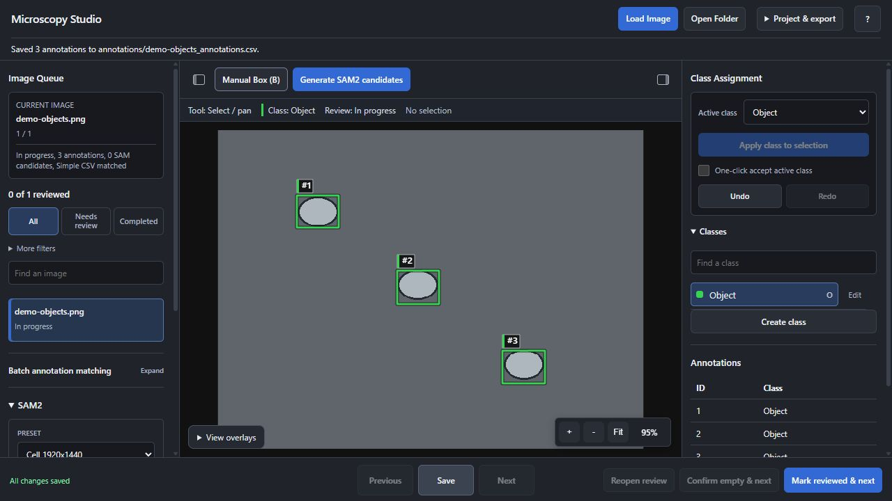

# Microscopy Studio

A local annotation tool for building object-detection datasets from microscopy images. Use SAM2 to suggest objects, or draw boxes yourself, then assign classes, review your images, and export the labels.


*The current interface, shown with synthetic objects and manually drawn boxes. No research or patient data is shown.*

- Open individual images or a folder, with search and review filters.
- Generate SAM2 candidates, draw and edit boxes, and undo or redo changes.
- Create your own classes, colors, and keyboard shortcuts.
- Keep projects separate and export CSV, YOLO, COCO, or Pascal VOC annotations.

## Get started

You need **Python 3.12** and the SAM2.1 large model. An NVIDIA GPU with a compatible driver is recommended; CPU inference is available but slower. The commands below use **Windows PowerShell and Conda**, from the repository folder.

```powershell
conda create -n microscopy-studio python=3.12 -y
conda activate microscopy-studio
python -m pip install -r requirements.txt
```

For NVIDIA acceleration, use the [official PyTorch installation instructions](https://pytorch.org/get-started/previous-versions/#v251) for **PyTorch 2.5.1 and torchvision 0.20.1**, matching this project's requirements and your GPU. A compatible CUDA-enabled build is needed for GPU inference.

Download the official [SAM2.1 large checkpoint](https://dl.fbaipublicfiles.com/segment_anything_2/092824/sam2.1_hiera_large.pt) into `models/sam2.1_hiera_large.pt`. Copy the included model configuration, then check and launch the app:

```powershell
New-Item -ItemType Directory -Force models | Out-Null
Copy-Item sam2/configs/sam2.1/sam2.1_hiera_l.yaml models/sam2.1_hiera_l.yaml
python scripts/check_setup.py
python app.py
```

Open **http://127.0.0.1:5000** in your browser. The app uses Waitress and runs locally; images are processed by your Python server.

## Annotate an image

1. **Open images.** Choose **Load Image** or **Open Folder**.
2. **Create classes.** Name the objects you want to label. Classes start empty in a new project.
3. **Add annotations.** Generate SAM2 candidates and assign a class to accept them, or use **Manual Box (B)** to draw your own. Select an annotation to edit its coordinates; Undo and Redo are available.
4. **Review.** Check the whole image, then choose **Mark reviewed & next**. Use **Confirm empty & next** only when there are no target objects. Both actions save before advancing.
5. **Export.** Open **Project & export**, choose a format, and export the current image. For a complete dataset, review every loaded image and choose **Export whole project (COCO)**.

**Save** stores annotations in the project's folder without marking the image reviewed. Pending annotation or class edits remain flagged as unsaved. Editing a reviewed image, or changing class names/IDs, requires another review. Unaccepted SAM candidates are not final annotations and are excluded from exports.

Use **?** for shortcuts. The side panels collapse to give the image more room. SAM2 presets cover routine use; device controls and tuning are under **Advanced settings**, with image preprocessing available separately. Active preprocessing affects both the display and SAM2 input while preserving the source file.

### Projects and saved work

Each `python app.py` launch reopens the active project. The project chooser appears when the browser first encounters that project. Reopen saved work under **Continue a project**, or create a named project with **Detect objects** (boxes) or **Outline objects** (instance segmentation). New projects start with empty classes unless you explicitly choose to reuse the current classes.

Use **Projects** in the header to reopen the chooser. Refreshing the browser, restarting the app, or switching back to a project restores its image folder, last image and review filter. Saved project choices show their annotation type. Annotations and review decisions reload from the files beside the images; unfinished drafts, unaccepted suggestions and unsaved edits are not resume bookmarks.

Folder bookmarks belong to the browser profile and app address (including the port). Use the same Chrome or Edge profile and address to resume automatically. If browser permission has expired, choose **Reconnect folder** in the header. If the folder handle is unavailable, **Locate folder** lets you select it again while retaining the last-image bookmark. Disabled browser storage requires selecting the folder again. A missing last image falls back to the first available image; a changed source image requires explicitly reopening the folder before editing.

Segmentation uses the same class rows as detection: select a colored row, use Edit to rename or change its color/shortcut, search by name, and use Add class to reveal the creation form. Changes save automatically. The trash button deletes a class after confirming how many annotations will be removed from the **current image only**. Undo/Ctrl+Z restores both the class and those annotations; Redo removes them again. Other images retain their annotations. Opening an image that still uses a removed class restores that class to the active list with its original ID. Folder autosave keeps the updated annotation beside its source image.

Classes have no fixed count cap. New classes receive generated colors beyond the starter palette; existing duplicate segmentation colors are repaired when the project loads. Colors persist with the project. Very large class sets can contain visually similar colors, so class names and object IDs remain important.

**Segmentation is being introduced in stages.** In an **Outline objects** project, open images, create a class, and choose **Polygon**. Click the corners of an object, then use **Finish** or Enter. Backspace removes the last draft point; Escape cancels the draft. Select an object by clicking its outline/fill or its object-list entry. You can change its class, delete it, or undo/redo these changes.

Drawing, Undo/Redo, and view controls sit above the canvas. As in detection, drag the image background to pan and scroll to zoom around the pointer; Fit image resets and centers the view. Object clicks and polygon handles retain their selection and editing behavior. Finish and Cancel appear only during polygon drawing. SAM2 accept, reject, and clear actions appear above the canvas when suggestions are available; click outlines or numbered canvas badges to select them. The shared Undo button also reverses accepted SAM2 batches.

**Saving in your project folder (refined UI):** use **Open folder** in Chrome or Edge and allow read/write access. Both detection and segmentation autosave beside each source image, including images in nested folders. Opening individual images also asks for their containing folder. The browser must support the File System Access API; unsupported browsers show an error instead of silently saving elsewhere. Folder access is remembered when browser storage is available; expired access shows **Reconnect folder**. Permission or disk errors leave edits marked unsaved; the Save control retries them.

Segmentation writes `image.json` beside `image.bmp` in LabelMe format. Detection uses the chosen CSV, rich CSV, YOLO, COCO, or VOC format and its usual export filename, with a `.review.json` companion for review status and class mapping. Existing annotation files are loaded before editing, and external file changes block overwriting until you reopen the folder. Images with the same stem in one folder must be renamed to avoid a shared annotation filename. No browser downloads or backup files are created by this folder-saving path. Older server-side files remain available for recovery; the server folder setting is an import location, not the save destination.

**Autosave is on for segmentation.** Completed shapes, accepted point edits, class assignments, deletions and undo/redo save immediately to the image's Labelme-compatible JSON file. Watch the **Saving… / Saved** indicator; editing and navigation briefly pause until the save completes. Unfinished drafts are not saved. If saving fails, edits remain in the current browser tab and **Retry save** becomes available. Closing or switching away from unsaved work warns before discarding it. A revision conflict requires reopening the image rather than overwriting another tab's changes.

**Review segmentation images:** Saved means the file is written; Reviewed means you checked the whole image. Use **Mark reviewed & next**, or **Confirm empty & next** when there are no target objects. Review saves to the same JSON before advancing to the next image needing review, skipping completed images and wrapping through the folder. The image queue shows progress and **All / Needs review / Reviewed** filters. Reopening the same project and folder restores review states from neighboring JSON files; files are checked in the background and unchecked files count as needing review. Existing files without a Studio review decision remain unfinished. Changed shapes, mismatched source images, or invalid files cannot retain completion. Resolve suggestions and finish or cancel drafts/previews before reviewing; save failures keep the image open with **Retry save** in the footer. Editing completed annotations reopens review, and Undo can restore the previous completed annotations and review decision. **Reopen review** explicitly makes the current image unfinished. Remaining suggestions trigger a warning before navigating away. Detection and segmentation exports retain their current scope.

**Opening segmentation work:** use **New project** or **Open project**, then **Files & annotations → Open folder** to select source images (including subfolders). All image formats supported by detection remain available. Use the image selector or previous/next arrows to navigate. A neighboring Labelme file with the same stem (`cell.tiff` and `cell.json`) imports automatically when that image is first opened. Existing project autosaves take priority, including saved empty annotations. Ambiguous matches are skipped for manual import. Original files are unchanged; autosaves belong to the active project. Reopening a project or refreshing restores its queue and position, subject to the browser's folder permission.

**Labelme JSON:** open the source image, then choose **Files & annotations → Import annotation**. The importer checks the image filename and dimensions, restores shape labels as project classes, and preserves polygon coordinates, grouping IDs, flags, descriptions, and additional annotation metadata. Import replaces the current image's objects after confirmation and autosaves them; Undo restores the previous objects. Newly discovered classes remain available after undo. Grouped polygons retain their grouping IDs but are edited as separate outlines.

Choose **Files & annotations → Download annotation** for a portable file named after the image. Place it beside the corresponding source image to open it in Labelme. Image pixels stay in the original file; embedded image data in imported JSON is not used to replace the open image. The import limit is 20 MB; for larger embedded files, save from Labelme without image data. PHI-safe exports use an anonymized image reference and require a source image with that matching filename. All existing image formats remain supported.

Polygon, rectangle and circle annotations are supported. A file containing unsupported shapes (such as lines, points, or masks), invalid shapes, or polygons exceeding 512 vertices is rejected in full with an explanation. Existing objects and classes are not partially replaced. Other shape types remain unsupported. Existing native `.studio.json` files remain readable and migrate to Labelme-compatible contents on their next successful save, with the previous file retained as a backup. Legacy server autosaves use image hashes; new folder autosaves use the source image's stem; optional `microscopy_studio` fields preserve stable app IDs and provenance without interfering with Labelme.

Reopen the same source images to restore their polygons. Image content hashes keep duplicate filenames separate, and saved class/object IDs remain stable. Scroll over the canvas to zoom toward the pointer, using the same wheel sensitivity as detection. **Fit image** restores the full image; canvas scrollbars let you reach other areas when zoomed in. Invalid or self-crossing polygons are rejected without replacing saved work.

To refine a completed polygon, select it to show its corners. **Drag a corner** to move it, or **click an edge** to insert a point there, then drag the new point as needed. **Right-click a corner** to remove it, or focus it with Tab and press Delete/Backspace. At least three points must remain. No separate edit mode is required. Escape cancels a move; Undo/Redo treats each move, insertion, or removal as one change. Invalid edits restore the previous outline; accepted edits save automatically.

**SAM2 suggestions** are available in segmentation projects. Choose a search mode under **SAM2 settings** and click **Suggest** above the canvas. Click outlines or numbered badges to toggle multiple selections; no modifier key is needed. The review bar shows pending suggestions, with class, Accept, Reject, and Deselect actions when suggestions are selected. Acceptance creates editable polygons and autosaves the entire batch. Toolbar Undo restores that batch as suggestions; Redo reapplies it. Clear suggestions removes pending outlines without deleting accepted objects. Escape clears the selection.

Suggestions are temporary and are replaced by another run or image change. Only accepted polygons persist. The current polygon format cannot represent holes or disconnected components: these masks and invalid contours are skipped with a count. Supported contours are simplified with a tolerance of at most two source pixels and validated before display. In crowded images, zoom or use the scrollable numbered list. Undo history lasts for the current image session; each successful SAM2 run is one undoable step, including replacement of existing suggestions. Undo restores the preceding suggestions; Redo restores the generated results without running inference again.

**Click-assisted SAM2:** **Click segment** creates a new object; select an existing object or one suggestion and choose **Correct** to replace its outline. The original boundary remains dashed white and the proposed boundary is gold. **Original** toggles the preview for comparison without changing annotations. Click inside an object to include it; use **Exclude** or right-click to remove unwanted areas. **Undo click** (Ctrl+Z) removes the latest prompt; **Cancel** (Escape) discards the preview. **Apply correction** or **Accept preview** saves one undoable edit. Repeated clicks reuse a cached image embedding; changing the image, applied preprocessing, project or model refreshes it. Previews must form one connected outline without holes. Segmentation exports retain their current scope. Detection tools and export formats remain available in detection projects.

**Precise local correction:** select a saved polygon and choose **Redraw edge**. Click two points on its outline to anchor the section, then place replacement points from the first anchor toward the second. The shorter boundary section is selected initially; **Other side** switches the section between the same anchors. Green shows the retained boundary, dashed white shows the section being replaced, and gold shows your replacement. **Original** compares with the original outline. **Apply edge** (Enter) validates the polygon and autosaves one undoable edit beside the image. Every untouched vertex keeps its exact coordinates; other objects, the object's ID and class are preserved. There is no SAM2 inference, raster conversion or boundary simplification in this tool.

During local correction, **Undo point** or Ctrl+Z removes the latest replacement point, then the end anchor, then the start anchor. Escape cancels without changing annotations. Middle-mouse panning and wheel zoom remain available. After Apply, Ctrl+Z restores the whole correction and Ctrl+Shift+Z redoes it. Invalid outlines remain in preview for correction; failed saves retain the applied edit as unsaved with **Retry save**. This tool works on polygons; native rectangles and circles retain their existing editing controls. The current single-outline/no-holes and 512-vertex limits still apply.

Segmentation's **Image processing** panel offers CLAHE, gamma, CLAHE + Unsharp,
gamma + Unsharp and mild Retinex. Choose a method, optionally open **Adjust
settings**, then **Apply**. **Reset settings** resets the input values; Apply
activates them. **Restore original** returns to the unprocessed preview. Each
application starts from the source file, preserving polygon geometry, zoom and
autosaved annotations. SAM2 uses the applied method and parameters, matching the
visible preview; changing controls without Apply does not change inference input.
Rerun SAM2 after applying processing to refresh suggestions. Opening an image resets processing to Original and defaults;
processing settings are not saved with annotations.

Opening another image folder does not switch projects. One server has one active project, so other tabs must reload after a project switch. Back up the annotation folders, their `.review.json` sidecars, `project_manifest.json`, and `project_manifest.json.projects/` together. Previous saved file versions are retained as `.bak` recovery copies.

### Import and export

| Format | Best suited to | Contents |
|---|---|---|
| Simple CSV | Basic label exchange | Boxes and classes |
| Rich CSV | Keeping SAM2 information | Boxes, contours, and available model metadata |
| YOLO TXT | Object-detection training | Normalized boxes and class IDs |
| COCO JSON | Dataset interchange | Boxes and available SAM contours; current image or whole project |
| Pascal VOC XML | VOC-compatible tools | Boxes and classes |

The **current-image export format** is independent of the project's save/import format, which is set under **Batch annotation matching**. Use that panel to match and import labels across loaded images, or **Current-image import** for one file. Imports replace the affected annotations.

Current-image exports can contain draft work. Whole-project COCO export requires reviewed images and valid annotations; unresolved matches and invalid geometry block it. Confirmed-empty images become negative examples. Class IDs stay stable when classes are renamed or reordered; deleted IDs are not reused, so YOLO IDs may contain gaps. Keep the matching class-ID mapping with your training data.

## Supported images

Common formats include **PNG, JPEG, BMP, TIFF, and WebP**, plus single-frame GIF, JPEG 2000, PNM, PCX, TGA, SGI, ICO, QOI, and XBM. Some formats depend on codecs available in Pillow.

The app works with **single 2D images converted to 8-bit RGB**. It does not preserve scientific intensities, physical units, or channel metadata. Render a 2D plane first for multichannel data, Z-stacks, time series, whole-slide images, or DICOM. Ambiguous multipage images and animations are rejected; TIFFs with a supported reduced overview are accepted. RAW, HEIC/HEIF, AVIF, SVG/PDF, and proprietary microscopy formats need conversion.

EXIF orientation is applied before display and annotation. Pair exported labels with images normalized to that same orientation. Original files are unchanged. The default decoded-image limit is **25 million pixels**.

## Configuration and troubleshooting

Most settings can stay at their defaults. If SAM2 is unavailable, check both files in `models/` and run `python scripts/check_setup.py`. For memory errors, try a lighter preset or reduce sampling in Advanced settings. Load the image before importing YOLO labels so its dimensions are available.

For duplicate filenames, use path-specific annotation matching. On a shared server, configure authentication and network access deliberately; the default address is localhost. PHI-safe mode hides identifying filenames in the interface and exports, but does not anonymize image pixels.

<details>
<summary>Environment variables</summary>

Set variables in PowerShell before launching, for example: `$env:APP_PORT = "5001"`.

| Variable | Purpose |
|---|---|
| `APP_HOST`, `APP_PORT` | Bind address and port; default `127.0.0.1:5000` |
| `APP_API_TOKEN` / `API_TOKEN` | Optional API bearer token; clients send `Authorization: Bearer …` or `X-API-Token` |
| `PHI_SAFE_MODE`, `PHI_HASH_SALT` | Set mode to `1` and supply a secret salt for stable anonymized filenames |
| `ANNOTATION_OUTPUT_DIR` | Default annotation folder; `annotations` |
| `ANNOTATION_FORMAT` | Save/import default: `csv`, `csv_rich`, `yolo`, `coco`, or `voc` |
| `PROJECT_MANIFEST_FILE` | Project manifest; `project_manifest.json` |
| `PROJECT_SETTINGS_FILE` | Legacy settings file used during initial migration |
| `ALLOWED_CORS_ORIGINS` | Allowed browser origins, comma-separated |
| `MAX_UPLOAD_MB`, `MAX_DECODED_IMAGE_PIXELS` | Upload and decoded-image limits |
| `SAM_DEVICE` | `auto`, `cuda`, or `cpu` |
| `SAM_MAX_CONCURRENT_REQUESTS` | Concurrent inference jobs; default `1` |
| `SAM_QUEUE_TIMEOUT_SECONDS` | Queue wait limit; default `5` seconds |
| `SAM_INFERENCE_TIMEOUT_SECONDS` | Request wait limit for inference; default `300` seconds |
| `MAX_ANNOTATIONS_PER_SAVE` | Annotation limit per save |
| `ALLOW_ABSOLUTE_ANNOTATION_DIR` | Set to `1` if absolute annotation paths are needed |
| `SKIP_SAM_MODEL_LOAD` | Set to `1` for UI/API work without inference |

The [example manifest](project_manifest.example.json) shows the project structure. Existing projects retain their saved settings.

</details>

<details>
<summary>Docker</summary>

The image downloads the SAM2.1 large checkpoint during the build. This example persists project state and annotations in `studio-data` and exposes the app only on localhost:

```powershell
docker build -t microscopy-studio .
docker run --rm -p 127.0.0.1:5000:5000 `
  -v "${PWD}/studio-data:/app/data" `
  -e PROJECT_MANIFEST_FILE=/app/data/project_manifest.json `
  -e ANNOTATION_OUTPUT_DIR=/app/data/annotations `
  -e ALLOW_ABSOLUTE_ANNOTATION_DIR=1 `
  microscopy-studio
```

For a local model mount, add `-v "${PWD}/models:/app/models"`; it must contain both model files. GPU use also requires a GPU-enabled container runtime and compatible PyTorch installation.

</details>

<details>
<summary>Development and tests</summary>

`app.py` coordinates the API; decoding, annotation formats, review persistence, and SAM2 inference have separate Python modules. The current UI uses `static/index-refined.html`, `script-refined.js`, and `style-refined.css`, with shared controllers. The preserved original interface is available at `?ui=original`; project-aware writes require the refined UI once a project library exists. Vendored upstream SAM2 code lives in `sam2/`.

Run tests with isolated runtime files and model loading disabled:

```powershell
python -m pip install -r requirements-ci.txt
New-Item -ItemType Directory -Force .tmp/tests | Out-Null
$env:SKIP_SAM_MODEL_LOAD = "1"
$env:PROJECT_SETTINGS_FILE = "$PWD/.tmp/tests/settings.json"
$env:PROJECT_MANIFEST_FILE = "$PWD/.tmp/tests/manifest.json"
$env:ANNOTATION_OUTPUT_DIR = "$PWD/.tmp/tests/annotations"
python -m pytest tests -q
python -m ruff check .
```

Node.js is needed for frontend tests. GitHub Actions runs the Python and frontend checks with CPU-only PyTorch. If Windows denies access to pytest temporary files, choose a new writable directory with `--basetemp`. Unset the test environment variables before returning to normal use, or open a new terminal.

The polygon editor's history, geometry, persistence, viewport and local tools live under `static/polygon/`. See the [module ownership and integration notes](docs/design/polygon-editor-modules.md) before editing those workflows.

</details>

## Acknowledgements

Microscopy Studio builds on **Meta FAIR's Segment Anything Model 2** and is not an official Meta project. Model weights are downloaded separately and are not committed here. If this annotator or SAM2-assisted outputs are useful in your research, please consider citing [Ravi et al., *SAM 2: Segment Anything in Images and Videos* (2024)](https://arxiv.org/abs/2408.00714).

[Official SAM2 repository](https://github.com/facebookresearch/sam2) · [Project page](https://ai.meta.com/research/sam2/)

Segmentation drawing tools use icons and shortcuts: **Polygon (1)** takes vertices and finishes with Enter; **Rectangle (2)** takes opposite corners; **Circle (3)** takes a center and an edge point. Rectangles and circles finish on the second click and remain native shapes in Labelme JSON. Select a shape to reveal its class, Correct, Split, Merge, and Delete actions above the canvas, or drag its handles to resize it. **Delete** on the keyboard removes the selected annotation and autosaves; Ctrl+Z restores it. Typing in text fields is unaffected, and Delete on a focused vertex still removes that vertex. The class under **New objects** controls creation; the selected object's class button edits only that object. Undo/Ctrl+Z removes draft points or reverses completed edits. Circles must fit inside the image.

To change an object's class, right-click its Saved objects row, use the row's **⋯** button, or click the selected shape's **#ID · class** badge. Choose a colored class entry to apply and autosave it. Drag inside a selected shape to move the entire shape; handles still resize it, and empty background still pans the image. Movement stops at the image boundary. Escape cancels a drag; Undo restores a move or class change.

Segmentation's **View** menu controls saved-object visibility, SAM2 suggestions, suggestion numbers, and outline-only display, plus Fit image. Suggestions use thin neutral-gray outlines with no fill by default; selected suggestions use a thin gold outline. Hiding suggestions deselects them without deleting them. Alt-click repeatedly at the same location to cycle through overlapping saved objects and toggle overlapping suggestions. Selecting an Objects row reveals saved outlines if hidden. Display changes are not annotation edits and do not autosave or enter Undo history.


**Split and Merge:** select one saved object or one SAM2 suggestion and choose **Split**, then click once inside each cell (2–16 cells). Review the separate outlines and choose **Accept split**. SAM2 treats the other cell clicks as exclusions, assigns overlapping predictions to the strongest cell prediction, and clips results to the original object. Background may be excluded; this does not force every pixel of the clump into a cell. Undo click removes the latest seed.

**Manual split:** select a saved polygon and choose **Cut line**. Click two points on its boundary; a straight cut previews two pieces immediately. Add points in order from the first anchor toward the second to bend the cut through the gap. Gold and blue distinguish the pieces; the white line shows the cut. **Original** compares the parent outline. **Apply split** (Enter) replaces the parent with two objects of the same class, assigns fresh IDs, and autosaves beside the image as one Undo/Redo step. All original outer vertices remain exact, and the two pieces cover the original area. No SAM2 prediction, rasterization or simplification is used. New pieces are manual edits; parent-specific LabelMe metadata is not copied to them.

Ctrl+Z removes draft cut points/anchors before Apply and restores the original object after Apply; Ctrl+Shift+Z redoes an applied split. Escape cancels without changing annotations. Middle-mouse panning and wheel zoom stay available. Cuts must stay inside the parent and produce exactly two valid polygons: crossing, boundary-touching, zero-area and over-limit pieces are rejected while retaining the draft. A failed save keeps the split as unsaved with Retry save. Rectangles, circles and unaccepted suggestions retain their existing tools; manual cutting applies to saved polygons.

For saved objects, choose **Merge** and toggle objects in the Saved objects list (or click their interiors). For pending suggestions, select them first, then choose **Merge**. Choose the output class beside **Accept merge**. Merge combines the selected regions at source-image pixel resolution; it never creates a bridge or fills a hole to make a result fit. Unsupported results show an error and keep the originals. Boundaries are simplified within the existing two-pixel tolerance. Cancel leaves annotations unchanged. Accepting either operation replaces only its source objects, assigns fresh object IDs, autosaves beside the image, and creates one Undo/Redo step. These operations create new objects; source-specific Labelme metadata is not copied to the new shapes. Undo restores the original objects and their metadata.
