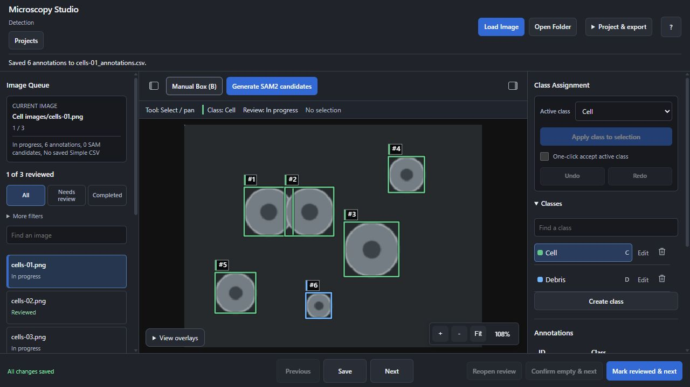
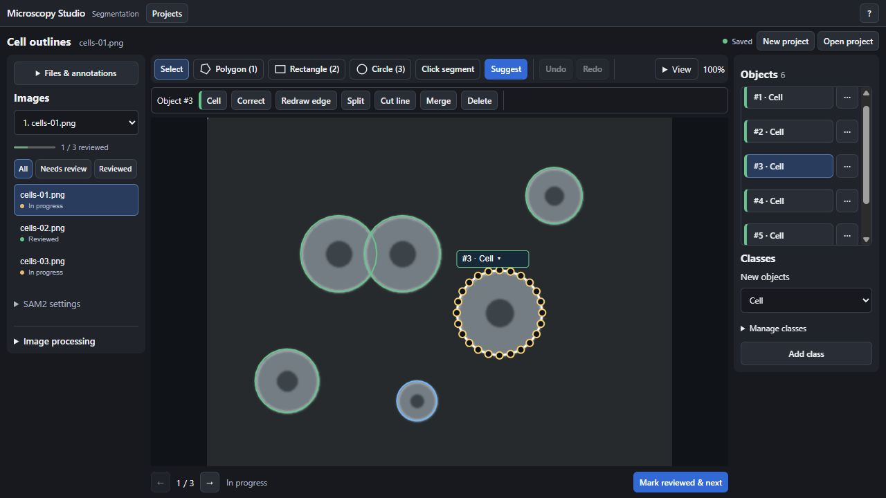

# Microscopy Studio

A local workspace for annotating microscopy images with boxes and object outlines. Draw manually or use SAM2 suggestions, refine your annotations, and review images at your own pace.

Your annotations save beside your images, and projects remember where you left off.

- **Boxes and outlines:** create classes, label objects, and edit their shapes.
- **Manual and assisted editing:** use SAM2, redraw part of a boundary, or separate touching cells with a cut line.
- **Review and resume:** track completed images and return to saved projects.
- **Save and export:** folder autosave, undo/redo, LabelMe JSON for outlines, and common detection formats.

**Detection — boxes, classes, and image review.**



**Segmentation — individual outlines and contextual editing tools.**



*Both screenshots show the current interface with synthetic cell images and manual annotations.*

## Get started

You need **Python 3.12**. An NVIDIA GPU is recommended for SAM2; CPU inference is available but slower. Use **Chrome or Edge** for saving directly to your image folder.

The commands below use Windows PowerShell and Conda:

```powershell
git clone https://github.com/HusnuBarisBaydargil/sam2-microscopy-studio.git
cd sam2-microscopy-studio
conda create -n microscopy-studio python=3.12 -y
conda activate microscopy-studio
python -m pip install -r requirements.txt
```

For GPU inference, install a CUDA-enabled build of **PyTorch 2.5.1 and torchvision 0.20.1** using the [official PyTorch instructions](https://pytorch.org/get-started/previous-versions/#v251).

Create the model folder, then download the [SAM2.1 large checkpoint](https://dl.fbaipublicfiles.com/segment_anything_2/092824/sam2.1_hiera_large.pt) into `models/sam2.1_hiera_large.pt`:

```powershell
New-Item -ItemType Directory -Force models | Out-Null
```

Copy the included configuration and launch:

```powershell
Copy-Item sam2/configs/sam2.1/sam2.1_hiera_l.yaml models/sam2.1_hiera_l.yaml
python scripts/check_setup.py
python app.py
```

Open **http://127.0.0.1:5000**. Image processing runs on your local Python server.

## Your first project

1. **Choose a mode.** Create a named project with **Detect objects** for boxes or **Outline objects** for instance segmentation.
2. **Open your images.** Choose **Open Folder** and allow read/write access. Existing matching annotations load from beside the images.
3. **Annotate.** Create a class, then draw objects or accept SAM2 suggestions. In segmentation, select an outline to move corners, redraw a section, split, merge, or change its class. **Cut line** splits a saved polygon without SAM2.
4. **Review.** Choose **Mark reviewed & next** after checking the whole image, or **Confirm empty & next** when there are no target objects. Queue filters help you find unfinished images.

Changes autosave beside the source image. **Saved** means the file is written; **Reviewed** means you checked the image. Editing a reviewed image makes it need review again. Unfinished drafts and unaccepted suggestions are not saved annotations.

Use **Ctrl+Z** to undo, **Ctrl+Shift+Z** to redo, and **Delete** to remove a selected annotation. Drag the background to pan; middle-mouse panning stays available while drawing or correcting outlines. Scroll to zoom. **?** opens the shortcut reference.

Use **Projects** to return to saved work. The app restores your folder, last image, and review filter in the same browser profile and app address. Choose **Reconnect folder** if permission expires, or **Locate folder** if the bookmark is unavailable. If a save fails, keep the tab open and use the save/retry control.

## Formats and limits

| Mode | Annotation formats |
| --- | --- |
| Detection | Simple or rich CSV, YOLO TXT, COCO JSON, Pascal VOC XML |
| Segmentation | LabelMe-compatible JSON with polygons, rectangles, and circles |

Segmentation saves `image.json` beside its source image and supports LabelMe import/download. Detection offers current-image exports and whole-project COCO export for reviewed images. Keep the class-ID mapping with exported training labels.

Common image formats include PNG, JPEG, BMP, TIFF, and WebP. Images are handled as **single 2D, 8-bit RGB views**; render a plane first for multichannel images, stacks, or time series. Original pixels remain unchanged. Polygon annotations support one outline without holes, up to **512 vertices**.

## For developers

`app.py` coordinates the API; the browser interface lives in `static/`. See the [polygon editor module guide](docs/design/polygon-editor-modules.md) for editing responsibilities. Vendored SAM2 code lives in `sam2/`.

<details>
<summary>Run tests</summary>

Use an activated environment and a separate terminal so test settings do not affect normal use. Node.js is required for frontend tests.

```powershell
python -m pip install -r requirements-ci.txt
New-Item -ItemType Directory -Force .tmp/tests | Out-Null
$env:SKIP_SAM_MODEL_LOAD = "1"
$env:PROJECT_SETTINGS_FILE = "$PWD/.tmp/tests/settings.json"
$env:PROJECT_MANIFEST_FILE = "$PWD/.tmp/tests/manifest.json"
$env:ANNOTATION_OUTPUT_DIR = ".tmp/tests/annotations"
python -m pytest tests -q
python -m ruff check .
```

GitHub Actions runs the Python and frontend checks with CPU-only PyTorch.

</details>

## Acknowledgements

Built on Meta FAIR's [Segment Anything Model 2](https://github.com/facebookresearch/sam2). This is an independent project; model weights are downloaded separately. For research using SAM2, please consider citing [Ravi et al., *SAM 2: Segment Anything in Images and Videos* (2024)](https://arxiv.org/abs/2408.00714).
